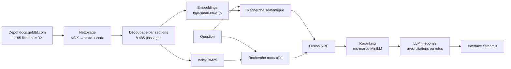

# dbt Docs Assistant — RAG avec évaluation chiffrée

Assistant conversationnel qui répond aux questions sur **dbt** à partir de la documentation officielle
([docs.getdbt.com](https://docs.getdbt.com)). Chaque affirmation renvoie à la section exacte de la doc.
Quand la documentation ne couvre pas la question, l'assistant **le dit au lieu d'inventer**.

Le projet couvre toute la chaîne : ingestion de la doc, découpage, recherche hybride avec reranking,
génération avec citations, interface locale et **évaluation sur 90 questions de référence**.

## Résultats

Évaluation sur un jeu de 90 questions écrites à la main (faits, procédures, comparaisons, questions
multi-pages, et 12 questions dont la réponse n'est **pas** dans la doc).

**Recherche** (78 questions avec réponse ; R@5 = la bonne page est dans les 5 premiers résultats)

| Mode | R@1 | R@3 | R@5 | R@10 | MRR |
|---|---|---|---|---|---|
| Mots-clés (BM25) | 0.38 | 0.65 | 0.76 | 0.82 | 0.53 |
| Sémantique (embeddings) | 0.56 | 0.74 | 0.91 | 0.94 | 0.69 |
| Hybride (fusion RRF) | 0.55 | 0.77 | 0.83 | 0.94 | 0.68 |
| **Hybride + reranking** | 0.49 | **0.79** | **0.94** | **0.97** | 0.67 |

**Réponses** (configuration retenue : `qwen3.8-flash`, top 5 passages)

| Mesure | Résultat |
|---|---|
| Refus corrects sur les questions sans réponse | **12/12** |
| Refus à tort sur des questions avec réponse | 2/78 |
| Réponses qui citent au moins une source | 76/76 |
| Page attendue citée | 91 % |
| Réponses entièrement appuyées par les passages (fidélité) | 75/76 |
| Réponses jugées justes / partielles / fausses par rapport à la référence | 58 / 16 / 1 sur 76 (1 illisible) |

Le coût total de l'évaluation (environ 1,3 M de tokens, toutes configurations comparées) est d'environ **0,20 €**.
Détails : [`eval/results/`](eval/results/).

### Limites constatées
- La justesse et la fidélité sont notées par un modèle « juge ». Une relecture manuelle d'un échantillon
  a trouvé des erreurs du juge sur les cas limites : ces deux chiffres sont indicatifs.
- Les réponses « partielles » sont surtout incomplètes (une nuance de version, une commande manquante)
  plutôt que fausses.
- Les questions formulées comme un vrai utilisateur (« mon modèle met des heures à se reconstruire… »)
  sont plus difficiles : R@5 de 0.67 sur ce sous-groupe (6 questions seulement).
- Le reranking tourne sur CPU : environ 10 s par question sur un PC portable.
- Les notes de version de dbt sont indexées et remontent parfois dans les sources.

## Architecture



| Brique | Choix | Pourquoi |
|---|---|---|
| Source | Dépôt GitHub `dbt-labs/docs.getdbt.com` | Doc open source en Markdown, URL stables pour citer |
| Nettoyage | Script maison (`clean_docs.py`) | Gère les composants MDX propres à la doc : onglets, extraits partagés, constantes, blocs de version |
| Découpage | Par titres, code jamais coupé | Un passage = une section lisible, avec son exemple de code et sa phrase d'introduction |
| Embeddings | `BAAI/bge-small-en-v1.5` via fastembed (ONNX) | Rapide sur CPU, sans PyTorch |
| Stockage | Fichier numpy | ~8 500 vecteurs : une base vectorielle serait superflue |
| Lexical | BM25 (`rank-bm25`) | Retrouve les noms exacts (`unique_key`, `--full-refresh`) |
| Reranking | `ms-marco-MiniLM-L-12-v2` | +11 points de R@5 par rapport à l'hybride seul |
| Génération | `qwen3.8-flash` via API compatible OpenAI | Coût très faible ; fournisseur réglable dans `.env` |
| Interface | Streamlit | Locale, sans coût pour les visiteurs |

## Lancer le projet

Prérequis : Python 3.10+, une clé d'API compatible OpenAI (Qwen par défaut).

```powershell
python -m venv .venv
.venv\Scripts\activate
pip install -r requirements.txt
copy .env.example .env          # puis renseigner LLM_API_KEY

# Construire la base (une seule fois)
python scripts/fetch_dbt_docs.py
python scripts/fetch_dbt_snippets.py
python -m src.ingestion.clean_docs
python -m src.ingestion.chunk_docs
python -m src.retrieval.build_index   # ~50 min sur CPU, reprenable après interruption

# Utiliser
streamlit run app/streamlit_app.py
python scripts/ask.py "What does the unique_key config do?"

# Évaluer
python scripts/eval_retrieval.py
python scripts/eval_generation.py
```

Les réponses du modèle sont mises en cache (`eval/results/answer_cache.jsonl`) : relancer l'évaluation
ne refait aucun appel payant.

## Structure

```
app/                  interface Streamlit
src/ingestion/        nettoyage de la doc et découpage en passages
src/retrieval/        embeddings, BM25, fusion, reranking (classe Retriever)
src/generation/       consigne, citations, refus, cache (classe Assistant)
scripts/              téléchargement, essais en ligne de commande, évaluations
eval/questions.jsonl  jeu de 90 questions avec pages attendues et réponses de référence
eval/results/         résultats chiffrés et réponses détaillées par question
```

## Statut

Pipeline, évaluation et interface terminés. À venir : vidéo de démonstration.
